# Dabber Khdma

Dossier de conception AWD semaine 4 · équipe de six membres

## 1 Objet du dossier et statut

Ce dossier prépare la validation intermédiaire AWD semaine 4 du projet Dabber Khdma. La plateforme relie clients et freelancers et prévoit l’import d’un CV pour préremplir le profil, puis le matching avec les offres de projets. La présentation et les diagrammes reprennent la marque fournie par l’utilisateur.
Le découpage comporte exactement six microservices métier : Catalogue, Propositions et sélection, Contrats et jalons, Communication, Notifications, Profil professionnel, CV et matching. L’authentification et la gestion des utilisateurs et profils constituent un socle commun supplémentaire, exclu de ce décompte. La Gateway n’est pas un microservice métier.
L’équipe comprend Rayen, Ayoub, Rana, Yassin, Farah et Oussama. Ayoub prend le profil professionnel, le CV et le matching. Les autres responsabilités sont proposées dans TEAM.md. La classe est SSA 9. Le groupe, la date, le lien Git public et le compte de l’enseignant restent à renseigner.
La consigne définit les livrables et l’organisation pédagogique. Le sujet, la marque, les règles métier et les technologies sont les choix de conception de l’équipe. Il s’agit d’un rendu de conception; les endpoints et traitements métier ne sont pas encore implémentés.

## 2 Problématique et objectifs

Les clients doivent trouver des compétences adaptées et suivre les livrables. Les freelancers doivent présenter leurs compétences et découvrir des offres pertinentes sans recopier tout leur parcours.
Dabber Khdma propose un premier parcours : importer un CV privé, consulter les champs extraits, corriger et confirmer le profil, rechercher un projet, envoyer une proposition, formaliser un accord de projet et suivre les jalons. Le paiement réel reste hors périmètre.
Le développement comporte deux étapes dans le service d’Ayoub : d’abord extraire le CV pour faciliter le profil; ensuite comparer les compétences confirmées avec les exigences des offres. Le matching est une fonctionnalité prévue, pas un septième microservice ni un service facultatif retiré de l’équipe.
Les paiements réels, l’escrow, l’entraînement d’un modèle et les applications mobiles sont hors périmètre initial. Les avis constituent une évolution après le parcours principal.

## 3 Acteurs et fonctionnalités

Le client publie des offres de projets, compare des propositions, attribue un projet, échange avec le freelancer et approuve les jalons. Le freelancer importe un CV, valide son profil, recherche des offres, candidate et remet les livrables. L’administrateur modère et traite les litiges avec des droits explicites.
La première étape CV comprend import privé PDF ou DOCX, extraction asynchrone, suggestions modifiables et confirmation des champs autorisés. La saisie manuelle du profil reste disponible. Le CV n’accorde aucun rôle et ne modifie pas les paramètres d’authentification.
La seconde étape compare les exigences des offres et le profil structuré confirmé, avec un score et une explication. Le client consulte les informations de profil autorisées, jamais le fichier CV brut par défaut.
Le fournisseur OIDC assure la connexion; le fournisseur courriel reçoit les envois autorisés. Les workers d’extraction et de matching appartiennent au sixième microservice, pas à de nouveaux services étudiants.

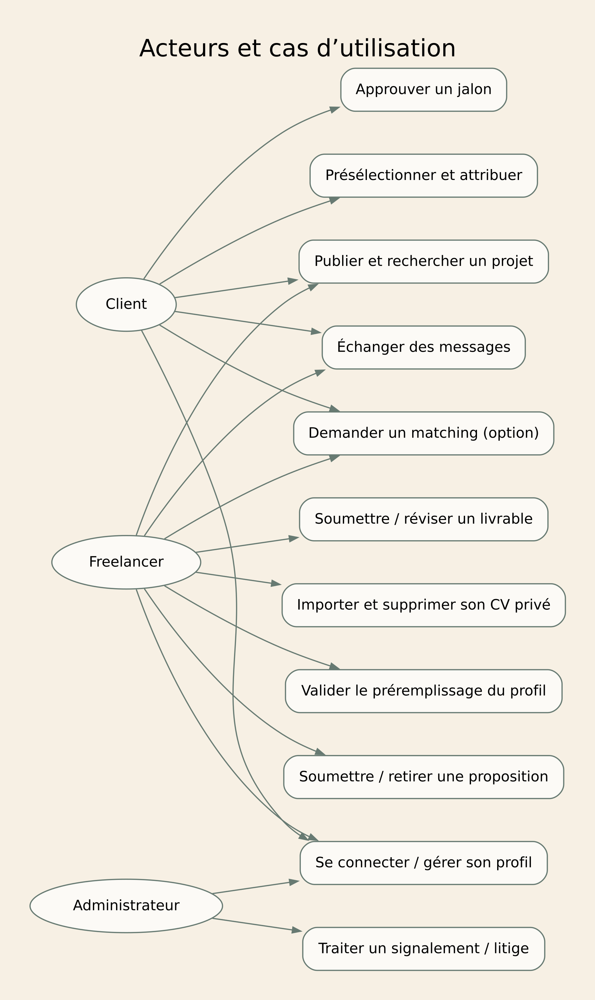

## 4 Règles métier et scénario principal

Un projet publié accepte des propositions; un brouillon reste visible uniquement par son propriétaire. Une seule proposition active existe par couple projet et freelancer. Un client ne peut pas candidater à son propre projet.
Une seule attribution peut réserver un projet. Catalog contrôle la disponibilité et l’annulation sous le même verrou local. Proposal utilise une clé stable, puis publie l’acceptation par outbox. Le contrat porte une contrainte unique sur proposalId.
Un livrable appartient à un jalon du contrat. Seul le freelancer contractant soumet; seul le client contractant approuve ou demande une révision motivée. Un litige suspend l’approbation et la clôture. Le contrat devient COMPLETED lorsque tous ses jalons obligatoires sont APPROVED et qu’aucun litige n’est ouvert.
Exemple fictif : un client publie un site vitrine avec budget en TND et compétences Java/TypeScript; un freelancer propose un montant, le client le sélectionne, le contrat devient visible après traitement asynchrone, puis le freelancer remet un livrable et le client l’approuve. Ces données servent uniquement à expliquer le parcours.

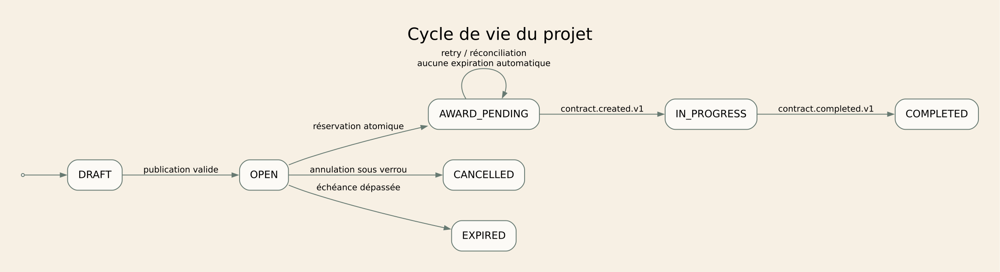

## 5 Architecture globale et sécurité

Le frontend Next.js/TypeScript appelle uniquement la Gateway et les API des microservices métier. Il ne connaît aucune adresse, clé ou endpoint du moteur IA. Aucun lien Frontend → IA ou Gateway → IA n’existe dans l’architecture.
Les six services métier sont Catalogue, Propositions, Contrats et jalons, Communication, Notifications et Profil professionnel/CV/Matching. Le socle authentification/comptes reste commun et hors décompte. Chaque backend possède sa base, contrôle les JWT et vérifie les droits sur ses ressources.
Pour Ayoub, un backend Spring Boot expose les routes /profiles, /resumes, /matches et /matching-jobs. Il détient les profils professionnels, documents, suggestions, versions et résultats dans sa base matching. Son worker backend consomme les tâches RabbitMQ, appelle le moteur IA Python/FastAPI privé puis valide et conserve le résultat. Le frontend reçoit toujours ce résultat par le backend métier.
Le moteur IA est un composant technique interne. Il reçoit uniquement les données nécessaires du backend et lui renvoie des suggestions ou scores. Il ne contacte ni navigateur, ni Gateway, ni bases métier, ni MinIO, ni RabbitMQ. Les fichiers sont lus par le backend puis transmis au calcul privé. Il ne modifie pas les règles d’accès ou les données validées.
Pour tout autre membre ajoutant une fonctionnalité IA, le même principe s’applique : son microservice métier expose le cas d’usage, contrôle l’autorisation, appelle son adaptateur IA privé et conserve la décision métier. Aucun nouveau moteur IA n’est annoncé pour les services qui n’ont pas encore de fonction IA définie.

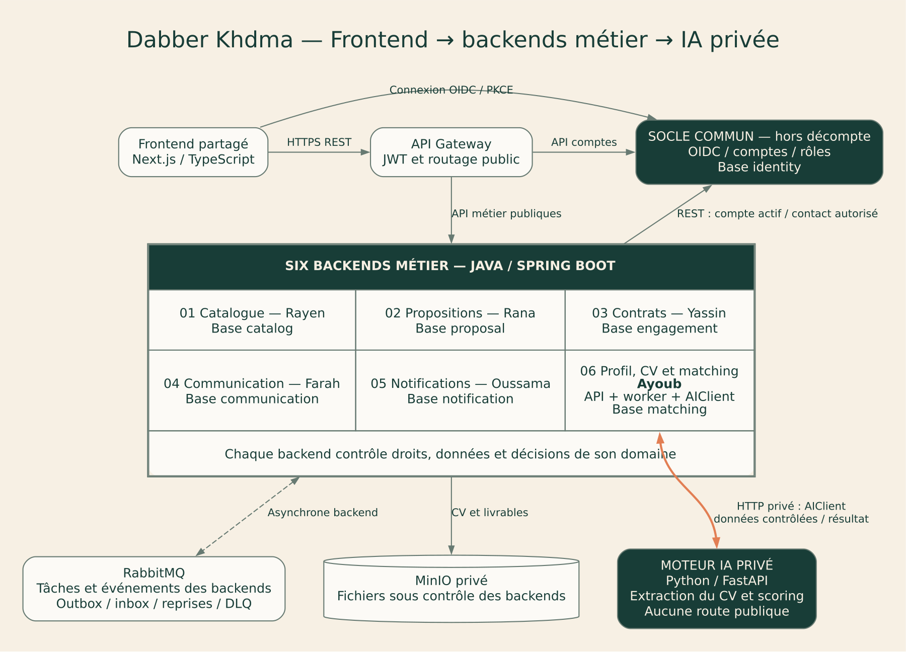

## 6 Choix technologiques et alternatives

Les API des six microservices métier et le socle comptes utilisent Java/Spring Boot dans la cible proposée; Spring Cloud Gateway fournit le point d’accès public et Spring Security valide les jetons. Les versions compatibles seront verrouillées au début du développement.
Le frontend partagé utilise Next.js et TypeScript. Les pages appellent les contrats publics des backends via la Gateway. Il n’y a ni microfrontend par étudiant ni clé de moteur IA embarquée.
Python/FastAPI est réservé au moteur IA privé. Le backend du domaine appelle ce moteur via un adaptateur HTTP typé et borné par un délai. Les calculs longs restent asynchrones du point de vue du navigateur : le backend retourne 202, le worker effectue le calcul interne et le frontend interroge le statut du backend.
PostgreSQL conserve les données métier par service; MinIO garde les fichiers privés sous contrôle du backend; RabbitMQ distribue les tâches et événements des backends. Outbox, inbox, contraintes locales et déduplication gèrent les reprises. Kafka et un second broker ne sont pas nécessaires au besoin décrit.

## 7 Socle commun Authentification et comptes

Le socle commun relie les comptes au fournisseur OIDC et gère pseudonyme, rôles, état du compte et coordonnées privées vérifiées. Il ne détient ni compétences, ni expériences, ni CV, ni profil professionnel.
Il est développé par toute l’équipe et présenté par Ayoub comme délégué; il reste hors des six microservices métier. GET /users/me lit le compte, PATCH /users/me modifie le pseudonyme et une action réservée aux administrateurs permet de suspendre un compte. Les mots de passe et la connexion relèvent du fournisseur OIDC.
UserAccount est associé à RoleAssignment. account.updated.v1 informe les backends concernés d’un changement d’état. Notification peut résoudre les coordonnées via une route interne dédiée, sans exposer ce contact dans les profils publics. Chaque service conserve son contrôle des droits et la règle de refus pour les comptes suspendus.

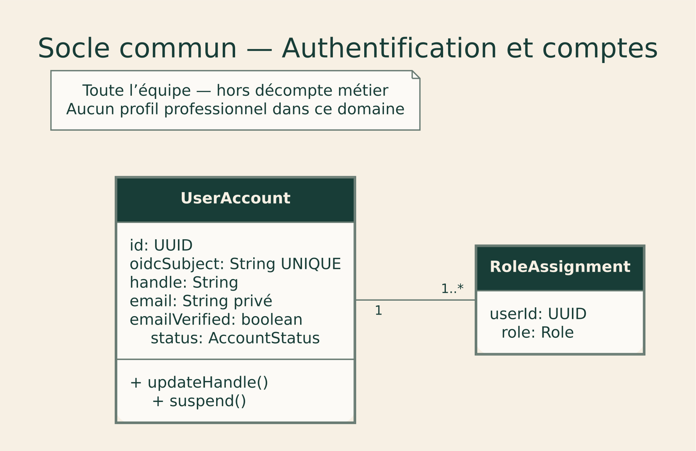

## 8 Microservice 1 Catalogue de projets

Gérer les projets, la recherche et la réservation atomique de l’unique attribution. Posséder la décision de disponibilité évite une course entre annulation et sélection.
Responsable : Rayen. Service métier 1 sur six. Base : catalog.
Données : Project (id: UUID, clientId: UUID externe, title: String, description: String, budgetMin: Decimal, budgetMax: Decimal, currency: String, status: ProjectStatus, version: long); ProjectSkill (projectId: UUID, skillCode: String externe, weight: int); Category (id: UUID, label: String); AwardReservation (projectId: UUID UNIQUE, proposalId: UUID externe, reservationKey: UUID UNIQUE, status: ReservationStatus).
Communication synchrone : Proposal appelle POST /internal/projects/{id}/award-reservations avec une identité de service et une clé stable.
Communication asynchrone : project.published.v1.
Principales routes : POST /projects → 201; GET /projects → 200; GET /projects/{id} → 200; POST /projects/{id}/publish → 200; POST /projects/{id}/cancel → 200; POST /internal/projects/{id}/award-reservations → 200.
Les contrats complets fournissent paramètres, schémas, exemples et codes d’erreur.

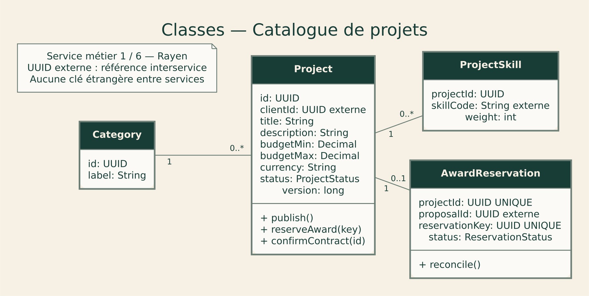

## 9 Microservice 2 Propositions et sélection

Créer et retirer les propositions, présélectionner et orchestrer l’attribution après réservation du projet.
Responsable : Rana. Service métier 2 sur six. Base : proposal.
Données : Proposal (id: UUID, projectId: UUID externe, freelancerId: UUID externe, amount: Decimal, currency: String, status: ProposalStatus); ProposalVersion (id: UUID, proposalId: UUID, version: int, coverLetter: String); Selection (projectId: UUID UNIQUE, proposalId: UUID UNIQUE, reservationKey: UUID UNIQUE, status: SelectionStatus); OutboxEvent (eventId: UUID, type: String, payload: JSON, publishedAt: Instant nullable).
Communication synchrone : Vérifie le projet et son propriétaire dans Catalog; réserve l’attribution avant le commit local de Selection et OutboxEvent.
Communication asynchrone : proposal.accepted.v1.
Principales routes : POST /projects/{id}/proposals → 201; GET /projects/{id}/proposals → 200; POST /proposals/{id}/shortlist → 200; POST /proposals/{id}/withdraw → 200; POST /proposals/{id}/accept → 202; GET /selections/{id} → 200.
Les contrats complets fournissent paramètres, schémas, exemples et codes d’erreur.

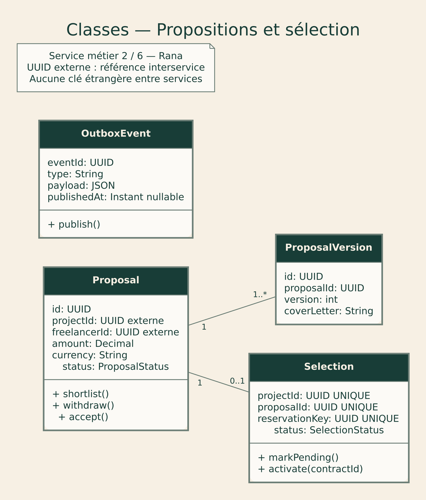

## 10 Microservice 3 Contrats et jalons

Créer un contrat par proposition retenue, gérer les jalons, livrables et litiges. Les paiements restent hors périmètre.
Responsable : Yassin. Service métier 3 sur six. Base : engagement.
Données : Contract (id: UUID, proposalId: UUID externe UNIQUE, projectId: UUID externe, clientId: UUID externe, freelancerId: UUID externe, status: ContractStatus); Milestone (id: UUID, contractId: UUID, title: String, amount: Decimal, currency: String, status: MilestoneStatus); Deliverable (id: UUID, milestoneId: UUID, objectKey: String, revision: int, scanStatus: ScanStatus); Dispute (id: UUID, contractId: UUID, reason: String, status: DisputeStatus, resolution: String nullable).
Communication synchrone : Communication appelle GET /contracts/{id} pour vérifier les participants; Engagement lit le stockage objet pour valider les métadonnées d’un livrable.
Communication asynchrone : contract.created.v1 / milestone.approved.v1.
Principales routes : GET /contracts/{id} → 200; POST /contracts/{id}/milestones → 201; POST /milestones/{id}/submit → 200; POST /milestones/{id}/approve → 200; POST /milestones/{id}/request-revision → 200; POST /contracts/{id}/disputes → 201.
Les contrats complets fournissent paramètres, schémas, exemples et codes d’erreur.

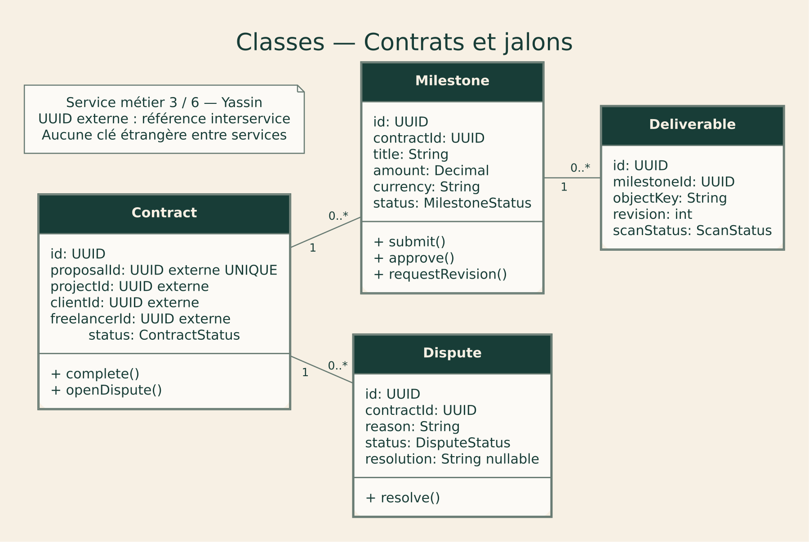

## 11 Microservice 4 Communication

Conserver les conversations et messages, vérifier les participants, limiter les abus et référencer les fichiers.
Responsable : Farah. Service métier 4 sur six. Base : communication.
Données : Conversation (id: UUID, contractId: UUID externe UNIQUE, createdAt: Instant); Participant (conversationId: UUID, userId: UUID externe, joinedAt: Instant); Message (id: UUID, conversationId: UUID, senderId: UUID externe, body: String, createdAt: Instant); Attachment (id: UUID, messageId: UUID, objectKey: String, mimeType: String, sizeBytes: long); ReadReceipt (messageId: UUID, userId: UUID externe, readAt: Instant).
Communication synchrone : Lit les participants du contrat par GET /contracts/{id} lors de l’ouverture; contrôle leur appartenance à chaque lecture/écriture.
Communication asynchrone : message.sent.v1.
Principales routes : GET /conversations → 200; GET /conversations/{id}/messages → 200; POST /conversations/{id}/messages → 201; POST /messages/{id}/read → 200.
Les contrats complets fournissent paramètres, schémas, exemples et codes d’erreur.

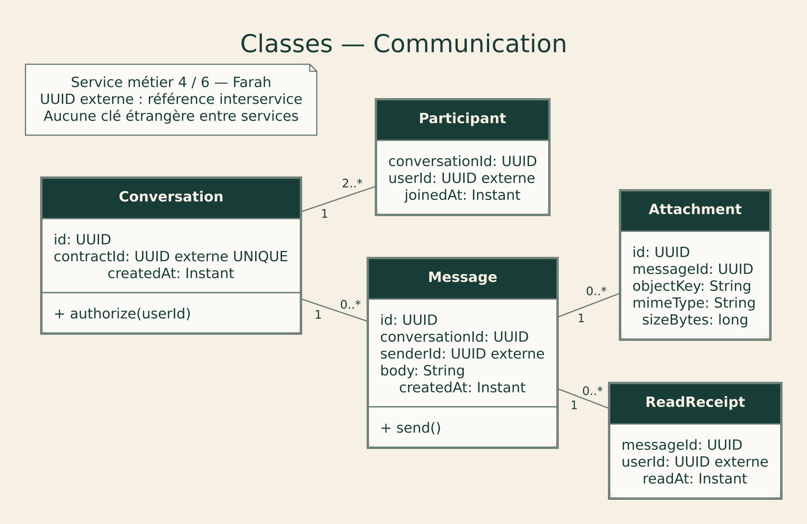

## 12 Microservice 5 Notifications

Créer une boîte de réception par utilisateur, appliquer les préférences et relancer les envois courriel.
Responsable : Oussama. Service métier 5 sur six. Base : notification.
Données : Notification (id: UUID, userId: UUID externe, eventId: UUID, type: String, readAt: Instant nullable); Preference (userId: UUID externe, emailEnabled: boolean, inAppEnabled: boolean); DeliveryAttempt (id: UUID, notificationId: UUID, attempt: int, status: DeliveryStatus, nextAttemptAt: Instant); InboxEvent (consumer: String, eventId: UUID, processedAt: Instant).
Communication synchrone : Le worker courriel récupère les coordonnées autorisées via une API interne limitée du socle Utilisateurs, puis contacte le fournisseur de messagerie.
Communication asynchrone : notification.email.requested.v1.
Principales routes : GET /notifications → 200; POST /notifications/{id}/read → 200; GET /notification-preferences → 200; PATCH /notification-preferences → 200.
Les contrats complets fournissent paramètres, schémas, exemples et codes d’erreur.

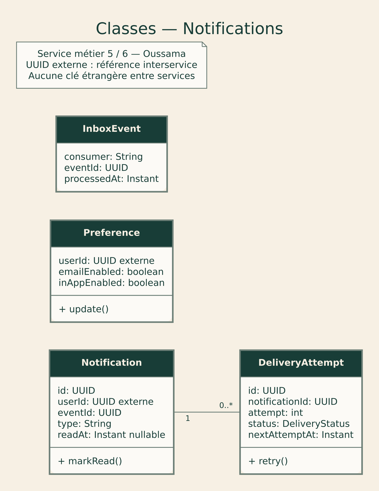

## 13 Microservice 6 Profil professionnel, CV et matching

Responsable : Ayoub. Ce sixième microservice métier possède le profil professionnel, le CV et le matching. Son backend Spring Boot expose les API publiques et orchestre les traitements. Le moteur IA privé réalise uniquement les calculs commandés par ce backend.
Données principales : ProfessionalProfile et ses compétences, expériences, formations, langues et portfolio; ResumeDocument, ExtractionJob et ProfileSuggestion; MatchingJob et MatchResult. Le compte d’authentification reste une référence externe au socle commun. Le profil est privé par défaut; sa publication exige une action explicite.
Backend : contrôleurs REST, validation, droits de propriété, version du profil, persistance PostgreSQL, fichiers privés MinIO, outbox et workers RabbitMQ. Un AIClient privé encapsule les appels /v1/extract et /v1/score. Les résultats sont validés et versionnés avant toute utilisation métier.
Frontend : import du CV, suivi du traitement, formulaire de profil et portfolio, relecture champ par champ des suggestions, prévisualisation du profil public, liste des offres recommandées et détail du score. Chaque écran appelle le backend métier par Gateway, jamais le moteur IA.
Les routes /profiles/me, /profiles/{id}, /profiles/me/resume-fill et /skills appartiennent à ce backend; /resumes gère le CV; /matches crée un job et /matching-jobs expose le statut et les résultats. Le détail des entrées, sorties, erreurs et versions figure dans son contrat OpenAPI.
La confirmation du CV vérifie localement propriétaire, état READY, extractionVersion et expectedProfileVersion. Les champs acceptés et l’outbox profile.updated.v1 sont commit dans la même transaction. Le CV ne peut modifier ni rôles ni coordonnées vérifiées. Le matching compare ensuite le profil confirmé aux offres ouvertes du Catalogue.

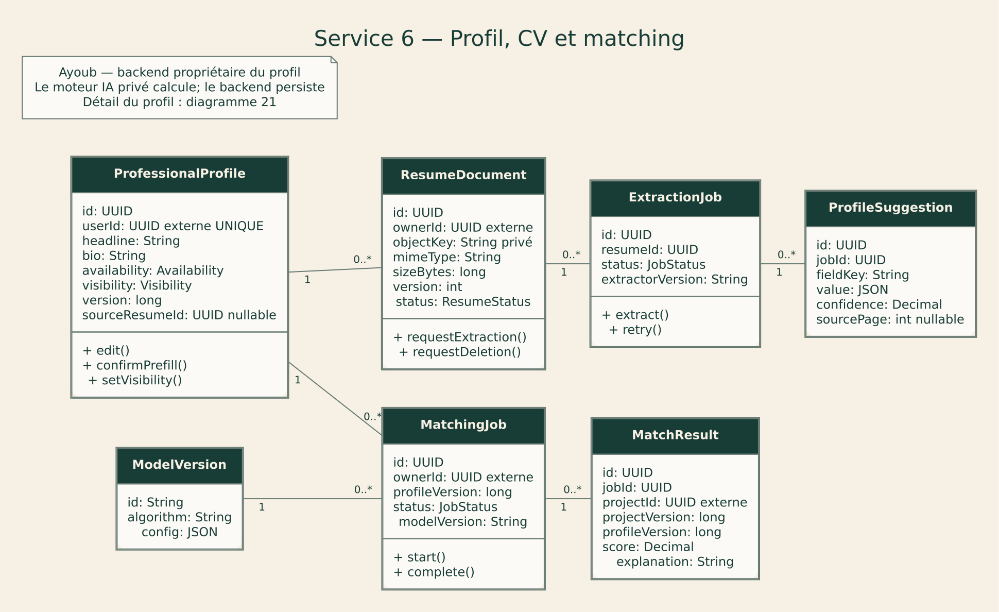

## 14 Travail backend d’Ayoub

Ayoub réalise le backend métier Profil professionnel/CV/Matching, identifié par le dossier ai-matching. Les routes publiques sont servies par Spring Boot et passent par la Gateway. Le moteur Python/FastAPI est privé et séparé de ces routes.
La couche contrôleur reçoit et valide les DTO; la couche applicative orchestre les cas d’usage; le domaine impose propriété, confirmation et versions; les repositories conservent les données PostgreSQL. Un AIClient avec adaptateur HTTP est la seule dépendance vers le moteur privé. Un faux adaptateur déterministe doit permettre les tests sans modèle externe.
Gestion du profil : lire et modifier son titre, biographie, compétences, expériences, formations, langues, disponibilité et portfolio; vérifier les tailles et URLs; gérer visibilité privée/publique et expectedProfileVersion. GET /profiles/{id} retourne uniquement un profil autorisé ou public, sans CV ni contact privé du compte.
Gestion du CV : contrôler PDF/DOCX, taille, quarantaine et propriétaire; enregistrer objet et métadonnées; créer une tâche durable; exposer statut et suggestions; appliquer seulement les champs confirmés; permettre remplacement et suppression sans résurrection par un worker tardif.
Matching : lire le profil confirmé localement, appeler Catalog pour les offres, créer le job backend et faire appeler /v1/score par son worker. Valider les résultats, versionner profil/offre/modèle, persister les raisons et exposer les états et résultats par API métier. Un timeout ou 503 du moteur produit reprise puis échec visible, sans bloquer la recherche.
Fiabilité : transaction métier + outbox, inbox/déduplication, délais et retries bornés, DLQ et journaux sans CV. Le backend contrôle l’état du compte et la propriété à chaque accès. Il n’expose aucun rôle, contact vérifié ou credential IA dans un formulaire de profil.
Livrables backend : contrat OpenAPI public, contrat IA interne, modèles et migrations, contrôleurs/services/repositories, AIClient, workers, configuration privée, scénarios d’autorisation et de concurrence, tests d’intégration et guide de reprise. Ces éléments sont des travaux à implémenter; le pack fournit leur conception.

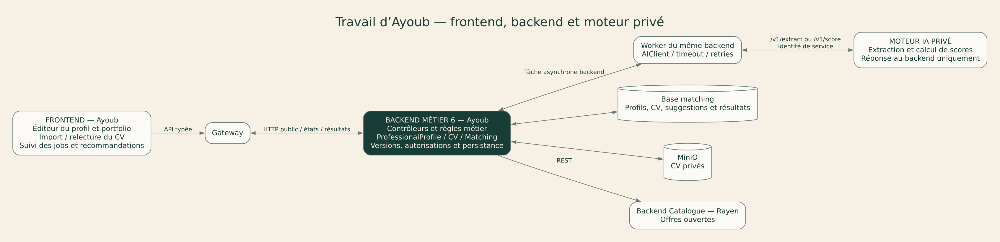

## 15 Travail frontend d’Ayoub

Ayoub réalise les pages du domaine dans le frontend Next.js partagé. Les appels utilisent un client API typé dirigé vers la Gateway et le backend métier. Aucun fetch vers FastAPI, aucune URL du moteur IA et aucun secret de service ne doivent apparaître dans le navigateur.
Éditeur de profil : sections titre et biographie, compétences et niveaux déclarés, expériences, formations, langues, disponibilité et portfolio. Permettre ajout, modification et suppression des éléments, afficher les validations et la version courante, sauvegarder par PATCH /profiles/me et préserver les saisies en cas d’erreur.
Import du CV : sélection d’un fichier, format et taille indiqués, message de confidentialité, progression de téléversement distincte du traitement. Après 202, suivre Location via le backend avec des requêtes bornées; afficher contrôle, attente, extraction, succès et erreur. Le navigateur ne sait pas quel moteur calcule en arrière-plan.
Relecture : présenter les suggestions champ par champ avec source et confiance indicative, permettre correction, sélection et exclusion. Rien n’est confirmé par défaut en silence. Le bouton de confirmation transmet resumeId, extractionVersion, expectedProfileVersion et confirmedFields au backend métier.
Profil public : fournir une prévisualisation et une commande explicite de visibilité. Montrer les informations professionnelles autorisées, sans fichier CV, adresse privée, rôles ou flags de sécurité. La saisie manuelle reste disponible si le CV échoue.
Recommandations : lancer POST /matches, afficher l’attente puis les offres classées, compétences communes/manquantes et versions. Permettre filtre vers une offre, accès au détail et candidature via le module de Rana. Signaler résultat obsolète et offrir un recalcul. La recherche Catalogue de Rayen reste utilisable sans IA.
Erreurs : 401 déclenche le parcours de connexion; 403/404 masque une ressource non autorisée; 409 propose de recharger et fusionner au lieu d’écraser; 413/415 explique le fichier refusé; 422 propose correction ou saisie manuelle; 429/503 fournit une reprise compréhensible. Les composants doivent être accessibles au clavier et sur mobile.
Livrables frontend : pages, formulaires et composants réutilisables, client API typé, gestion des jobs et états d’erreur, prévisualisation et recommandations, mocks cohérents avec les contrats et tests du parcours CV → profil confirmé → offres. Le frontend n’exécute aucune décision d’autorisation ou de scoring à la place du backend.

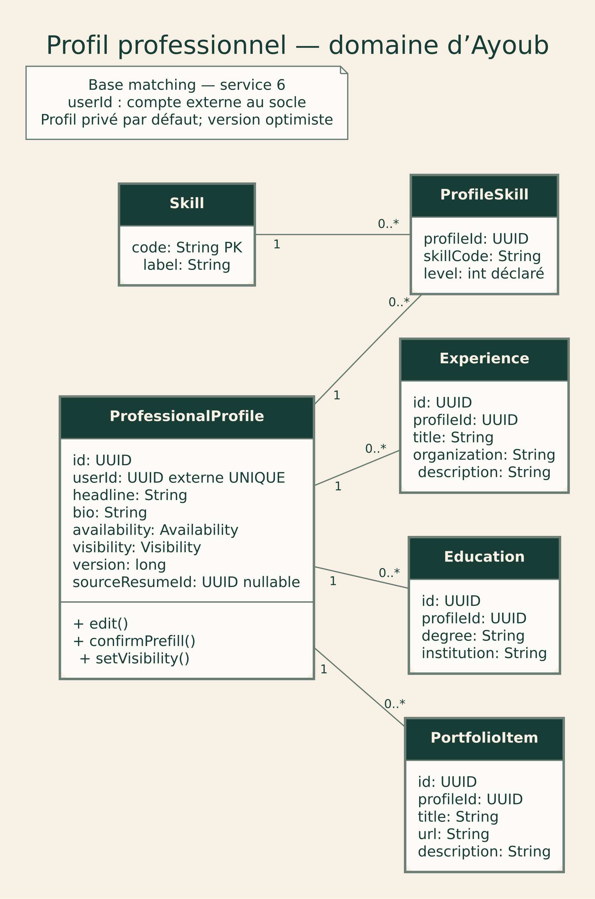

## 16 Attribution et cohérence distribuée

1. Proposal stocke une intention durable associant la clé d’idempotence et le candidat, puis demande à Catalog une réservation atomique. Catalog contrôle OPEN, le propriétaire, le candidat et l’absence de réservation; annulation et réservation partagent le verrou du projet.
2. La même clé retourne la même réservation. Un concurrent reçoit 409. Le projet passe AWARD_PENDING. Proposal commit la sélection PENDING_CONTRACT, l’état ACCEPTED et l’événement proposal.accepted dans son outbox. Les autres propositions actives du projet deviennent REJECTED.
3. Engagement consomme l’événement, déduplique par eventId, crée le contrat avec UNIQUE(proposalId), commit son outbox, puis acquitte. contract.created active la sélection, passe le projet IN_PROGRESS et ouvre la conversation.
4. Une panne entre réservation et commit local conserve l’intention et impose une réconciliation avec la même clé. Aucune libération automatique de réservation ne doit permettre un second contrat. Les réservations bloquées nécessitent un rapprochement Catalog/Proposal/Engagement puis une décision opérateur tracée.
Le navigateur reçoit 202 avec Location et affiche « attribution en cours ». Aucun 202 ne garantit que le contrat existe déjà. La reprise privilégie la cohérence de l’attribution à une disponibilité illimitée.

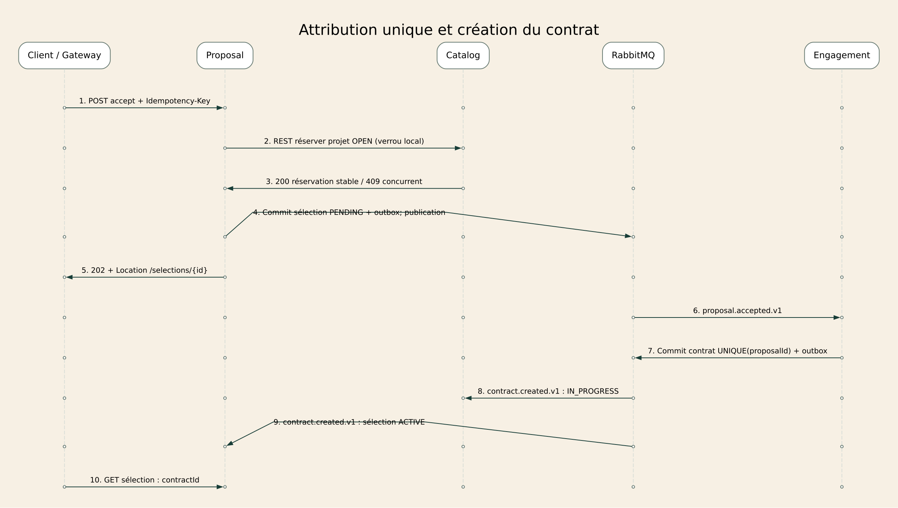

## 17 Messages et notifications fiables

Communication contrôle le participant, puis enregistre message et outbox dans une seule transaction. Il retourne 201 après commit. RabbitMQ transporte uniquement les références et destinataires; la base Communication conserve l’historique.
Notification consomme dans une file propre, applique les préférences, déduplique par (eventId,userId,type), enregistre la notification et crée si nécessaire une demande courriel. L’acquittement intervient après le commit. Les doublons de livraison du broker ne doivent produire qu’une notification.
Les tentatives sont proposées à t=0 puis après 5, 30 et 120 secondes. Le dernier échec va en DLQ avec alerte et outil de reprise. Le fournisseur de courriel peut encore recevoir un doublon si sa réponse se perd; utiliser son mécanisme d’idempotence lorsqu’il existe et tracer le statut « incertain » autrement.

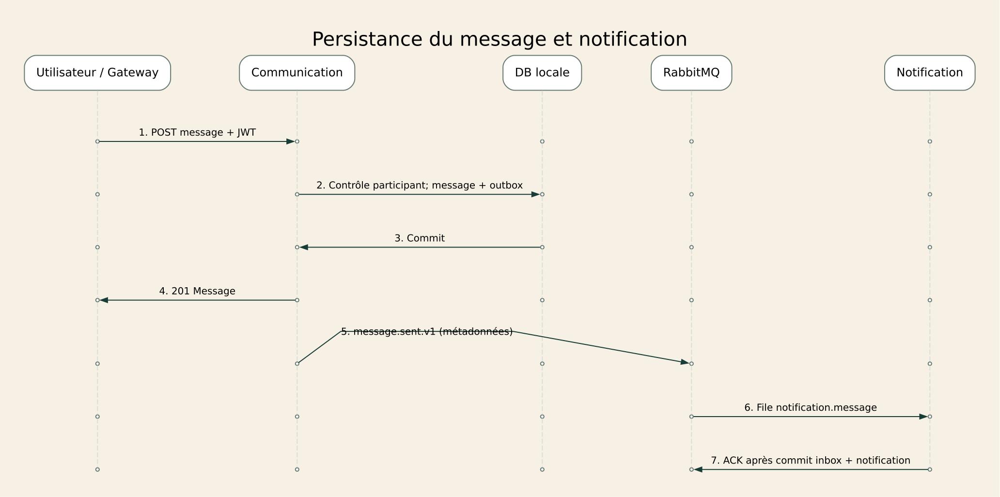

## 18 Import du CV et préremplissage confirmé

Le frontend envoie un CV privé à POST /resumes sur le backend métier d’Ayoub via la Gateway. Les formats proposés sont PDF textuel et DOCX sans macros, pour 5 Mo maximum. Le backend contrôle le propriétaire, le type réel, la taille et la sécurité du document, le place en quarantaine et n’autorise le calcul qu’après un contrôle réussi.
Le backend conserve ResumeDocument et une outbox resume.uploaded.v1 puis retourne 202 avec Location. Son worker backend récupère le fichier depuis MinIO et appelle le moteur IA privé avec les octets autorisés et un identifiant de calcul. Le moteur retourne des suggestions et une version d’extracteur au backend; il ne contacte pas le navigateur et ne persiste pas le profil.
Le backend valide les champs autorisés, leur format, le document et la version, persiste ProfileSuggestion puis passe le document READY et émet resume.parsed.v1. Le frontend lit l’état et les suggestions via ce même backend.
L’utilisateur peut corriger et confirmer le nom affiché, le titre professionnel, la biographie, les compétences, expériences, formations, langues et éléments de portfolio autorisés. POST /profiles/me/resume-fill porte resumeId, extractionVersion, expectedProfileVersion et confirmedFields. Le backend contrôle ces données dans sa base locale et n’applique que les champs confirmés. Un conflit retourne 409 sans écraser la modification concurrente.
Un PDF scanné sans texte, protégé ou inexploitable produit une erreur claire et propose la saisie manuelle. Aucune extraction ne modifie rôle, mot de passe, contact vérifié ou réputation. Le CV est traité comme des données, sans exécuter ses instructions ni suivre ses liens.
La suppression passe DELETION_PENDING puis DELETED après effacement du fichier, des extractions et suggestions. Un worker tardif ne peut réintroduire ces données. Le profil déjà confirmé reste modifiable par l’utilisateur. La politique de conservation proposée reste de supprimer après 30 jours les imports non confirmés; elle doit être validée par l’équipe avant mise en production.

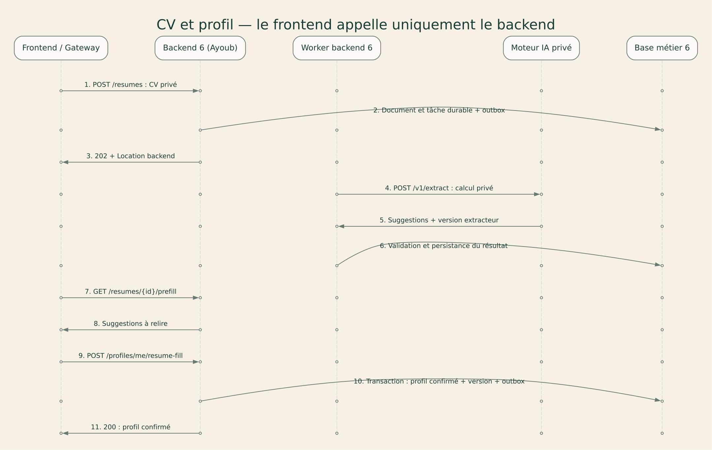

## 19 États et reprise du traitement du CV

Cycle prévu : UPLOADED puis SCANNING, QUEUED, EXTRACTING et READY. Une vérification ou extraction en échec produit FAILED avec un motif compréhensible; une relance explicite conserve l’historique de version. DELETION_PENDING bloque toute nouvelle extraction et DELETED constitue la fin du cycle.
Les écritures de résultat vérifient la version et le statut courant. Un worker tardif ne peut remettre un document supprimé en READY. Les clés d’idempotence et l’inbox dédupliquent les jobs. Un message en erreur suit les reprises bornées et la DLQ. Le suivi distingue le statut du document, le statut du job et le fait que le profil ait réellement été confirmé.

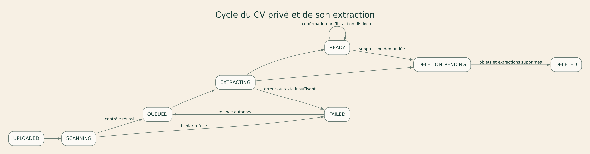

## 20 Vérification des six microservices et contributions

1 — Rayen : Catalogue de projets, base catalog; backend projets et recherche, frontend publication et consultation d’offres.
2 — Rana : Propositions et sélection, base proposal; backend candidatures et attribution, frontend dépôt, comparaison et suivi de sélection.
3 — Yassin : Contrats et jalons, base engagement; backend contrats/livrables/litiges, frontend suivi de contrat et validation des jalons.
4 — Farah : Communication, base communication; backend conversations et participants, frontend messagerie et historique.
5 — Oussama : Notifications, base notification; backend préférences et livraisons, frontend boîte de notifications et préférences.
6 — Ayoub : Profil professionnel, CV et matching, base matching; backend profil et orchestration IA privée, frontend éditeur de profil, CV et recommandations.
Hors décompte — Toute l’équipe : authentification OIDC et comptes, base identity. Le moteur IA Python, les workers et la Gateway sont des composants techniques, pas de nouvelles responsabilités métier étudiantes.
L’application frontend Next.js est commune; chaque membre réalise les pages et composants liés à son domaine. Un backend reste responsable de ses droits et décisions, même lorsqu’il appelle un moteur IA privé.

## 21 Matching explicable et autonomie du parcours

Le frontend demande des recommandations par POST /matches au backend d’Ayoub. Le backend lit son propre profil professionnel confirmé et sa version, puis récupère les offres ouvertes du Catalogue par REST. Il crée MatchingJob et sa tâche durable avant de retourner 202.
Le worker backend transmet au moteur IA privé uniquement les compétences confirmées et les exigences des offres. Le moteur calcule les scores et renvoie des compétences communes/manquantes au backend. Il n’a aucun accès direct aux utilisateurs, au frontend ou aux bases métier. Le backend valide les identifiants d’offres et les scores, construit les explications et persiste MatchResult avec profileVersion, projectVersion et modelVersion.
La baseline est une couverture pondérée des compétences requises, entre 0 et 1. Un profil sans compétence confirmée doit être complété plutôt que recevoir un score artificiel. Le budget reste un filtre de recherche tant qu’un tarif fiable n’existe pas. Les informations sensibles comme photo, date de naissance et situation familiale sont exclues du calcul.
Le frontend lit le statut et les résultats via /matching-jobs/{id}; il montre l’offre, les raisons, les compétences manquantes et la fraîcheur du résultat. Un résultat dépassé par une nouvelle version du profil est signalé comme obsolète et peut être recalculé. La recherche et la candidature restent possibles si le moteur IA est indisponible.
Un projectId optionnel limite le calcul à une offre précise; sans ce filtre, le backend recommande des offres ouvertes au profil connecté. Une panne du moteur est traitée par les reprises du worker backend et ne fait jamais apparaître une URL privée d’IA dans l’interface.

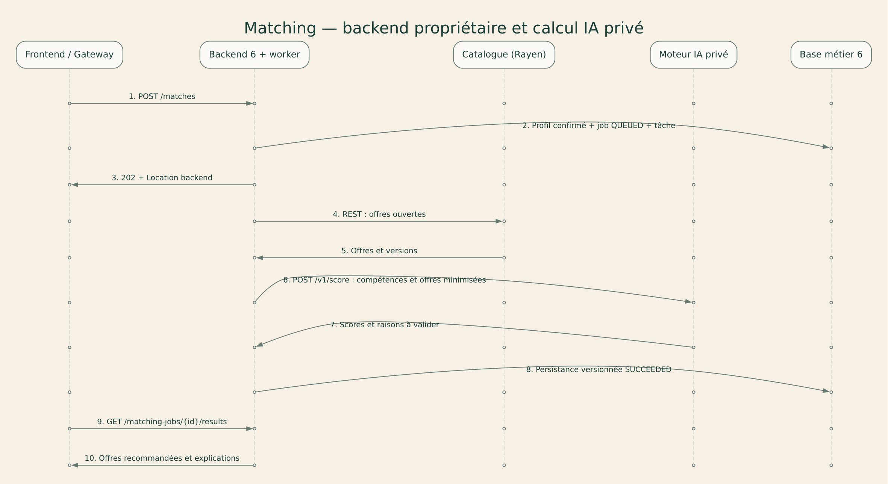

## 22 Données et contraintes de persistance

Le socle identity conserve uniquement UserAccount, rôles et coordonnées privées de compte. Le backend d’Ayoub possède ProfessionalProfile et ses tables liées dans matching, ainsi que les CV, extractions, suggestions et résultats. Les autres services conservent leurs propres domaines. Les UUID externes n’introduisent aucune clé étrangère entre bases.
ProfessionalProfile.userId est unique; ProfileSkill est unique par couple profil/compétence. Les expériences, formations et éléments de portfolio référencent localement le profil. Une mutation de profil ou confirmation incrémente version et écrit l’outbox dans la même transaction. Le remplacement de listes de compétences ou d’expériences exige la version attendue.
Le fichier CV reste dans un bucket privé sous le contrôle du backend. Le moteur IA reçoit les octets utiles du backend, sans accès direct au stockage ou aux bases. Les contrats, réservations, sélections, inbox et notifications conservent leurs contraintes d’unicité décrites dans les SQL de conception.
Une modification du profil rend les anciens résultats de matching identifiables comme obsolètes. Les événements ne contiennent ni CV, ni texte privé, ni coordonnées. Les schémas SQL fournis sont une conception à convertir en migrations après revue; aucun transfert de données d’une application existante n’est prétendu réalisé.

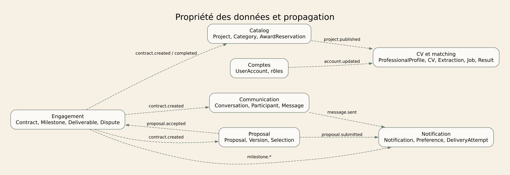

## 23 Autorisations et protection des données

Un utilisateur authentifié lit et modifie son propre profil. Le profil public ne révèle ni adresse courriel ni informations privées. Un client gère uniquement ses projets et sélectionne leurs propositions; un freelancer gère uniquement ses propositions et livrables.
Chaque endpoint portant un UUID vérifie la relation entre le principal et la ressource. Pour masquer l’existence d’une ressource privée, le service peut retourner 404 de manière cohérente. Les fichiers restent privés. Les conversations appartiennent uniquement à leurs participants.
Valider les tailles, formats, transitions et champs; échapper le contenu au rendu; interdire les secrets dans Git; limiter les tentatives et tracer les actions d’attribution, d’approbation et de modération. Les journaux incluent traceId mais excluent jetons, mots de passe et texte privé.
Politique proposée à confirmer : suppression des brouillons abandonnés après 90 jours; conservation des contrats pour la durée justifiée par les besoins du projet; aucune durée légale n’est affirmée ici. Les règles de conservation et les procédures de suppression doivent être arrêtées avant une mise en production.

## 24 Déploiement et observabilité

La démonstration envisagée sépare le frontend, la Gateway publique, les six backends métier, le socle comptes et un réseau privé contenant moteur IA, PostgreSQL, RabbitMQ et MinIO. La Gateway ne route jamais les endpoints du moteur IA. Aucune adresse ni clé privée de calcul n’est présente dans le bundle frontend.
Le moteur IA n’accepte que des identités de service autorisées, avec audience et scopes dédiés. Le worker du backend possède les credentials nécessaires. Le moteur reçoit des données contrôlées par HTTP interne et renvoie ses résultats au backend; ses accès directs au navigateur, aux bases, au stockage et au broker sont absents de la cible.
Les métriques suivent erreurs HTTP, délais du moteur IA, taille des files backend, ancienneté des jobs et outbox, réservations bloquées et DLQ. Les traceId/correlationId relient commande frontend, traitement backend et appel IA sans journaliser les CV ou secrets. L’absence de CORS public complète la protection réseau mais ne remplace pas l’authentification de service.
La CI fournie valide le dossier et les contrats. Les tests Java, frontend, Python et de reprise seront ajoutés avec les implémentations. Les PDF et diagrammes décrivent cette cible, sans prétendre qu’elle est déployée.

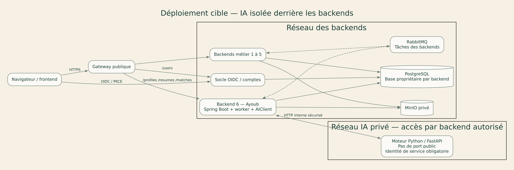

## 25 Organisation Git et répartition

Le dépôt contient Backend, Frontend, Documentation, Submission et README.md. Les six backends métier appartiennent respectivement à Rayen, Rana, Yassin, Farah, Oussama et Ayoub. Chaque membre réalise aussi les écrans et intégrations frontend de son domaine dans une seule application Next.js commune.
Ayoub possède profil professionnel, CV et matching; le socle commun possède authentification et comptes. Le backend d’Ayoub est l’unique point d’accès de son frontend au calcul IA privé. Tout autre membre introduisant de l’IA doit la relier à son backend via un adaptateur, avec contrats et tests d’erreur; aucun appel frontend vers un moteur privé n’est autorisé.
Les branches feature/DK-xx-sujet et pull requests associent changements backend, frontend, contrats et critères d’acceptation. Les interfaces communes, OIDC, Gateway, conventions et intégration restent partagés. Les tâches sont précisées dans Mission_Ayoub_Backend_Frontend.md et Repartition_Backend_Frontend.md.

## 26 Planning et méthode de travail

S0 correspond à la validation semaine 4 : architecture, diagrammes, contrats, marque et responsabilités. S1 construit le socle, le catalogue et l’import CV privé avec extraction initiale. S2 intègre la confirmation du profil, les propositions, l’attribution, les contrats et les jalons. S3 relie communication, notifications et interface avec les tests de reprise. S4 met en œuvre le matching avec les offres à partir des profils confirmés.
Le matching est planifié après la première étape CV. Les dates réelles et la durée des sprints restent à fixer selon le calendrier du cours. Le travail d’Ayoub couvre les deux phases d’un même microservice métier.
Definition of Ready : comportement, contrat, dépendances, propriétaire et critères testables. Definition of Done : code relu, contrôles adaptés réussis, contrat synchronisé et démonstration reproductible. Les estimations restent à revoir par l’équipe.

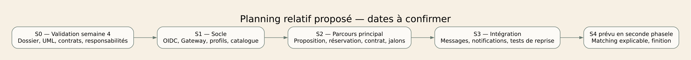

## 27 Risques et mesures proposées

Surdimensionnement — probabilité élevée, impact élevé : conserver les six services et limiter les fonctionnalités de chaque sprint; matching planifié après le CV; démontrer d’abord un seul parcours.
Double attribution ou annulation concurrente — probabilité moyenne, impact élevé : réservation dans Catalog sous verrou, clés stables, contraintes uniques et tests concurrents.
Panne de broker ou contrat non créé — probabilité moyenne, impact élevé : outbox, confirmations, déduplication, réconciliation et alertes sur AWARD_PENDING.
Accès aux ressources d’un autre utilisateur — probabilité moyenne, impact élevé : contrôle propriétaire à chaque service et tests négatifs.
Retard d’intégration frontend — probabilité élevée, impact moyen : contrats en premier, exemples HTTP et états d’attente visibles.
Matching peu pertinent — probabilité élevée, impact moyen : baseline déterministe, jeu d’exemples annotés, explications et recherche classique.
Informations de remise manquantes — probabilité élevée tant qu’elles restent vides, impact élevé : compléter classe/groupe, dépôt public et accès enseignant avant Blackboard.
Extraction erronée ou document malveillant — impact élevé : quarantaine, contrôle de format, traitement isolé, provenance des suggestions et validation humaine avant persistance.
Fuite de CV — impact élevé : stockage privé par propriétaire, aucun CV dans les événements, contrôle de chaque accès et suppression traçable.

## 28 Plan de validation et critères de réussite

T01 — Un brouillon reste inaccessible aux autres comptes; publication rend le projet visible dans la recherche.
T02 — Une seconde proposition active pour le même couple renvoie 409; la candidature du propriétaire est refusée.
T03 — Deux acceptations concurrentes et une annulation concurrente aboutissent à une seule réservation; aucun contrat n’apparaît pour un perdant.
T04 — Rejouer proposal.accepted avec le même eventId, puis un nouvel eventId portant le même proposalId, conserve un seul contrat.
T05 — Arrêter le publisher après commit métier conserve l’outbox; son redémarrage publie sans perte et sans effets métier en double.
T06 — Arrêter Proposal après réservation mais avant commit local laisse une intention récupérable; la réconciliation utilise la même clé.
T07 — Un tiers ne peut lire contrat, conversation, livrable ou job d’un autre utilisateur; aucun effet métier ne suit le refus.
T08 — Un jalon en litige ne peut être approuvé; une révision conserve l’historique et exige une nouvelle soumission.
T09 — Un message consommé deux fois ne crée qu’une notification; un message invalide finit en DLQ après les essais prévus.
T10 — Un job IA en échec laisse recherche et candidature utilisables; seul son propriétaire consulte les résultats.
Ces scénarios sont planifiés pour le développement. Ils n’ont pas été exécutés sur une application métier. Le contrôle actuel vérifie les fichiers, relations de contrats et exports du pack.
T11 — Un CV d’un autre utilisateur ne peut être lu, prérempli ou supprimé. Un fichier trop volumineux retourne 413 et un type refusé 415.
T12 — Aucun champ extrait n’entre dans le profil avant confirmation; modifier le CV ne modifie pas rôles, droits ou adresse vérifiée.
T13 — Une confirmation avec expectedProfileVersion périmée retourne 409 et conserve le profil courant.
T14 — Après suppression ou changement de version du CV, un worker tardif ne réintroduit aucune suggestion.
T15 — Le matching utilise uniquement la version confirmée; les compétences non validées et champs sensibles n’influencent pas le score.
T16 — Le frontend, la Gateway et un jeton utilisateur ne peuvent appeler le moteur IA privé; seules les identités de backend avec scope valide sont acceptées.
T17 — Une modification manuelle de profil augmente sa version, conserve les champs non modifiés et invalide les anciens résultats.
T18 — Le moteur IA indisponible laisse l’éditeur, le profil et la recherche utilisables; le frontend suit uniquement le statut backend.
T19 — La réponse publique du profil n’expose ni CV, ni coordonnées de compte, ni rôles.
T20 — Le résultat IA ne peut modifier aucun champ non autorisé; le backend vérifie schéma, propriétaire, versions et identifiants avant persistance.

## 29 Présentation et discussion

La présentation comprend 19 diapositives et dure environ 13 minutes 40 secondes. Chacun des six membres présente son microservice pendant 50 secondes. Le service Profil professionnel, CV et matching est présenté par Ayoub. Le socle comptes commun est présenté séparément par Ayoub en tant que délégué et ne compte pas parmi les six.
Les parties groupe sont réparties entre les six membres; le guide oral indique les diapositives, intervenants et durées. Rayen présente la couverture et l’architecture; Rana la problématique et les acteurs; Yassin l’attribution et le planning; Farah le parcours CV et les technologies; Oussama l’organisation, les risques et la remise; Ayoub le socle commun et le détail de l’import CV.
Une discussion de dix minutes suit la présentation. Tous les membres doivent comprendre le pipeline CV, le consentement de confirmation, la propriété des données, le matching versionné, les contrats d’API et la cohérence de l’attribution.
La présentation précise le travail backend et frontend d’Ayoub et le passage obligatoire par le backend pour toute fonction IA. Le nombre de services métier reste six.

## 30 Traçabilité des exigences et remise

Source : consigne enseignant, pages 1 à 3, copiée dans Documentation/References. Page 1 : dépôt et dossiers obligatoires, idée, fonctionnalités, architecture, données et technologies. Page 2 : responsabilités, planning, risques, classes et interactions par service, contrats API et service commun; présentation de 10 à 15 minutes et discussion de 10 minutes. Pages 2 et 3 : dépôt public avec enseignant collaborateur, dossier technique, présentation et architecture sur Blackboard; conception attendue sans finalisation applicative.
Le dossier Submission contient les fichiers à téléverser et un texte de remise à compléter. Le lien Git public et l’invitation collaborateur sont des actions externes restant à réaliser. Un seul membre dépose la remise Blackboard.
Les champs inconnus restent visibles dans TEAM.md et le modèle de remise. Ils empêchent de qualifier ce paquet de remise administrative terminée, même si les livrables de conception sont fournis.

## 31 Références techniques

Consigne locale : Documentation/References/Consigne_enseignant.pdf, trois pages. Brouillon Dabber Khdma existant : Technical_Design_Draft.md à la racine du dossier de travail initial, utilisé comme base de projet et non comme consigne pédagogique.
RabbitMQ, Consumer Acknowledgements and Publisher Confirms : https://www.rabbitmq.com/docs/confirms — distinction entre confirmation au producteur et traitement consommateur.
Spring Security, OAuth 2.0 Resource Server JWT : https://docs.spring.io/spring-security/reference/servlet/oauth2/resource-server/jwt.html — validation des jetons et configuration de l’émetteur.
PostgreSQL, Constraints : https://www.postgresql.org/docs/current/ddl-constraints.html — intégrité et contraintes uniques locales.
Consultation des trois documentations officielles le 9 novembre 2026. Les mécanismes outbox, réservation et reprise sont des choix d’architecture proposés par l’équipe; les références n’attestent pas leur implémentation.
Identité visuelle : dossier local /home/ashenix/Desktop/dabber-khdma-brand, logos SVG, tokens.json et guide fournis par l’utilisateur. Les couleurs et la typographie de la présentation proviennent de cette source.